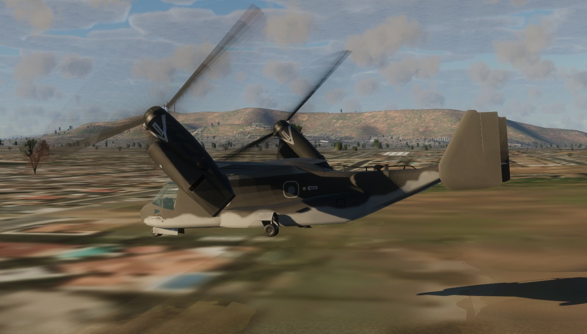

# Bell Boeing MV-22B Osprey for FlightGear, with a JSBSim tiltrotor model



The MV-22B Osprey from FlightGear's aircraft collection, with a new JSBSim
flight model in place of its YASim one. A tiltrotor hovers on two large,
highly twisted proprotors, tilts them through a corridor of nacelle angle
against airspeed and cruises on its wing with the rotors as propellers; each
rotor's disc tilts as a whole on its gimbal, and in the hover the wing sits in
their downwash. The model is built around those rotors. The V-22's own
engineering data aren't public, but those of its technology demonstrator, the
Bell XV-15, are. So the model is built and checked as an XV-15 first, and then
carried to the V-22 with what Boeing, Bell and NASA have published about it:

- Bell's real-time simulation of the XV-15 (NASA CR-114614): every wind
  tunnel table of its wing, fuselage and tail, its control mixing and
  governor,
- NASA's hover test of the full-scale XV-15 rotor (TM-86833) and the XV-15's
  level-flight power in flight (TM-84222),
- the V-22's rotor, wing, airframe polar, download, hover ceilings and flight
  envelope (Rosenstein and Clark, 12th ERF), and its flight test through the
  conversion (Dunford et al., 16th ERF).

How it was built, and the comparisons test by test, are in the report:
[MV22B-JSBSim-model-report.pdf](MV22B-JSBSim-model-report.pdf). How to fly
it, every system, mode and procedure, is in the flight manual:
[MV22B-flight-manual.pdf](MV22B-flight-manual.pdf).

## What's simulated

- **Proprotors.** Each rotor's three blades are simulated one by one on a
  gimbal, so the disc tilts as a whole, with the blades' 2.5° of precone and
  their pitch–flap coupling (δ3 = −15°). Eight aerodynamic segments per blade
  see the air at their own angle of attack and Mach number: the aircraft's
  motion, the nacelle's tilting, the rotation, the gimbal's tilt and the
  induced flow. Their sections are built from the V-22's published thickness
  and camber distribution (Boeing's XN sections, 28 % thick at the root to
  9 % at the tip), with a stall fitted to the full-scale XV-15 rotor's hover
  power. The blades are twisted 47.5° from root to tip, as the V-22's.
- **Inflow.** A dynamic wake (Peters–He) for each rotor, with ground effect.
  A ring-vortex wake carries each rotor's downwash to the wing, the
  horizontal tail and the two fins, for any nacelle angle, speed and
  direction.
- **Nacelles.** They tilt at up to 8°/s from 97.5° (7.5° aft of vertical)
  to 0°, airplane mode. The conversion protection holds them inside the
  V-22's corridor of nacelle angle against airspeed.
- **Airframe** from Bell's XV-15 tables, carried to the V-22's wing, tail and
  fuselage. The wing is four strips a side in the rotors' wakes, its download
  in the hover depending on the flaperons, as on the XV-15 in flight. The
  airframe's drag is fitted to Boeing's polar for the V-22.
- **Flaperons** droop to 67° in the hover, where they take the most wing out
  of the downwash, and 40° through the conversion and in slow airplane mode,
  and retract as the speed builds, all automatically.
- **Engines and drive.** Two engines of 6150 shp, geared together through the
  interconnect shaft: one rotor speed, so either engine drives both rotors.
  The drive's torque limit is fitted to Boeing's hover ceiling. The collective
  governor holds 104 % rotor speed in helicopter mode and through the
  conversion, 84 % in airplane mode.
- **Fuel.** The MV-22B's five tanks (1448 US gal), drained in the transfer
  sequence's order: the aft sponson first, then the forward sponsons, the
  feed tanks last. The engines stop when they run dry.
- **Flight controls.** The thrust control lever, stick and pedals mix to both
  rotors' collective and cyclic as on the XV-15, phased with the nacelle
  angle, while the elevator, rudders and flaperons work in all modes. The
  real V-22 flies by wire and its control laws aren't public, so the
  augmentation here is a common rotorcraft design. At low speed the stick
  commands an attitude, the pedals a yaw rate, and the heading holds; above
  50 kt (55 kt accelerating, 45 kt slowing) the stick commands a rate and
  holds the attitude you leave it at. A trim schedule keeps the stick's
  centre trimmed through the conversion.
- **Hover hold.** One press (HVR CPLD, or `y`) at up to 40 kt over the
  ground shows where the aircraft will stop, stops there at 0.08 g and holds
  the spot, the heading and the height, translating on its nacelles with the
  fuselage level. The stick out of its centre flies it at up to 10 kt (2 kt
  with REM HVR) and on release it stops and holds again; the lever flies
  through the height hold, and left alone for 1.5 s holds the new height.
  It is built after the AH-64D's and Bell's hover holds and checked against
  ADS-33E's position hold (see the report).
- **Autopilot.** A flight director that the augmentation flies when coupled
  (CPLD), as the V-22's does: heading, altitude and speed holds, the route
  manager's route, an ILS or VOR, and an approach that slows down along an
  ILS's glide slope, a runway's path or a landing zone's to a hover 50 ft over
  its point, and lands there. Speed and altitude share the lever and the pitch
  as Boeing's total energy control does in airplane mode, and on the back side
  of the power curve the lever flies the climb; AUTO NAC sets the nacelles for
  the speed from the model's own trims, within the conversion corridor.
  Terrain following plans a path over the scenery's terrain 45 s ahead along
  the track, the lowest that clears it by the set height with the pull-ups
  its ride allows and the climb the engines can make, and flies it through a
  model of the aircraft's own climb response, measured from the flight model.

All of it is JSBSim XML, generated by a script from the transcribed data; no
Nasal runs the flight model.

## Install

Get the files:

```bash
git clone https://github.com/MrChillStorm/MV-22.git
```

Then add the cloned `MV-22` folder in the FlightGear launcher under Add-ons →
Additional aircraft folders (or start FlightGear with `--fg-aircraft=`
pointing at it), and pick **Bell Boeing MV-22B Osprey (JSBSim)**.

- Needs FlightGear 2024.2 or later. The model, lights, liveries and rotors are
  built for the HDR renderer.
- The model runs at 480 Hz, which the rotors' gimbals need. In FlightGear
  every property read takes a lock, so the rest runs slower (the wake states
  and controls at 120 Hz, the airframe, engines and outputs at 60 Hz) and the
  blade elements are written to read little: about 3200 reads a step.
- The aircraft is in the `MV-22B` folder with the id `mv22b`, so it sits next
  to the V-22 from the hangar without replacing it.
- In multiplayer, other pilots need this aircraft installed to see yours as
  this MV-22B; without it they see the stock V-22.

## Flying it

- **Start.** On the ground the aircraft starts cold and dark. In the air it
  starts running and trimmed in level flight at whatever airspeed it starts
  at, the nacelles at AUTO NAC's angle for it. For its first 5.5 s it holds
  still while it trims, as an offline trim does: the rotors come up to the
  model's own level-flight trim for the airspeed, weight, density altitude
  and gear (`fdm/trimmap.py --start`), then the nose turns to the trim's
  pitch with the flight path held, and the collective, the lever and the
  stick are trimmed on the forces and pitching moment the held airframe
  feels, for level flight even where FlightGear starts it on a slight climb.
  Let go, it flies on level hands off: within 15 ft over 30 s from the
  hover to 250 kt, light or heavy, at 1500 or 10,000 ft
  (`fdm/aptest.py instart`). The V22 Osprey menu's AutoStart/AutoStop, or
  `}`, starts one engine after the other; with the lever down the rotors
  reach their governed speed about 75 s after the first engine lights.
- **Thrust control lever** is the throttle axis, or Page Up/Page Down: up is
  more collective in helicopter mode, more power in airplane mode. At the
  start's weight (below) a hover needs about two thirds of it; at the
  aircraft's maximum vertical take-off weight nearly all.
- **Nacelles.** `m` tilts the command 10° forward, `M` 10° aft; they move at
  the conversion rate. Below 35 kt they won't go further forward than 75°,
  and they follow the corridor as you accelerate, so pressing `m` until the
  command is fully forward lets them convert as the speed allows. From 90°,
  `M` tilts them 7.5° aft of vertical, to stop or back up in the hover. If you
  slow down below the corridor for your nacelle angle, the conversion
  protection raises them. The NACELLE thumbwheel on either thrust control
  lever does the same: click it, or turn the mouse wheel over it.
- **Stick and pedals.** Below 50 kt with the nacelles above 60°, each 5 % of
  stick (one arrow-key press) holds about 1° of pitch or 1.25° of bank, each
  5 % of pedal turns the aircraft at 1.5°/s, and the heading holds while the
  pedals are centred. Above it the stick commands a rate and the aircraft
  holds the attitude you release it at. Hands off, the aircraft holds its
  attitude through a conversion.
- **Hover hold** `y` (HVR CPLD on the flight control panel) at up to 40 kt
  over the ground with the nacelles past 70°: the flight display turns to its
  hover format with the stop point (a magenta box, filled once it holds it,
  also on the map) and the line and ball pointing to it, and the mode line
  shows HVR CPLD DECEL, HOLD, or TRC while the stick flies it. The hold moves
  the lever and the nacelles itself. Move the stick to translate, the lever to
  change height; past half the stick, 45 kt, or on landing it lets go (HVR
  CPLD OFF in amber). `Y` (HVR ALT HOLD) holds the radar height set on the
  panel's HVR ALT knob, taking the present one when pressed. REM HVR slows
  the stick to 2 kt for precise positioning.
- **Autopilot.** Pick the modes on the flight control panel or the keys, and
  couple them with CPLD (`u`); the stick out of its centre uncouples (CPLD OFF
  in amber), and the modes stay as flight director cues. The knobs set the
  heading bug, speed and altitude; a hold takes the present one when pressed.
  - HDG HOLD `Ctrl-H`, ALT HOLD `Ctrl-A`, SPD HOLD `Ctrl-S`, AUTO NAC `U`.
    Engaged in a climb, or slow, ALT and SPD HOLD start from the vertical
    speed and acceleration there are and change them at no more than 0.1 g
    (the speed's in energy terms), so the nose doesn't jump;
  - WYPT `Ctrl-W`: the route manager's route, straight to its first waypoint,
    then turning before each one on an arc that joins the two legs (up to
    150°). It flies the plan the NAV format draws: APPR arms with the route,
    so it slows down from the DECEL point, descends on the approach path and
    comes to a hover at the route's last point (`Ctrl-G` then lands);
  - VOR/ILS `Ctrl-N`: NAV 1's localizer and glide slope, or its VOR on the
    CRS knob's course;
  - APPR `Ctrl-G`: an approach to a hover 50 ft over the ILS's threshold
    (NAV 1 tuned to it), or the route's destination runway or last waypoint
    (a landing zone, into the wind, at 6°). It slows down along the path at
    1.5 kt/s, hands over to the hover hold at 35 kt and holds the hover;
    `Ctrl-G` again lands there (at 2 ft/s, the lever down after), a third
    time cancels;
  - GA `Ctrl-U`: go around, holding the heading and climbing to the ALT
    knob's altitude (or 1000 ft up) at the speed knob's speed (at least
    80 kt);
  - TF `Ctrl-T`: terrain following at the HVR ALT knob's clearance (200 ft if
    it's below 100), from 40 kt over the ground. On the CDU `T300` sets the
    clearance (100–1000 ft) and `R1`, `R2`, `R3` the ride (soft, medium,
    hard: 0.1, 0.2, 0.3 g up or down). It flies the vertical; with SPD HOLD
    the speed is free within 20 kt of the knob's, so the climbs and descents
    trade it against height. Below half the clearance, or without terrain
    data, it climbs at full power (FLY UP, TF FAIL on the mode line, else
    TF 300 MED). Pressed again it ends, the ALT knob set to the present
    altitude. Engaging it turns APPR off; an approach's glide path, once
    captured, takes the vertical over from it.

  The approach line arms until the aircraft is within 20 s of flight of it
  (HDG or WYPT flying meanwhile) and is drawn on the NAV format; the flight
  format's mode line shows the modes (green when coupled) and the approach's
  phase and distance.
- **Rotor speed** is governed: 104 % in helicopter mode and through the
  conversion, 84 % in airplane mode (with the nacelles at 0°).
- **Fuel and payload.** Equipment → Fuel and Payload. A flight starts with
  the tanks half full, three crew and no cargo: 38,730 lb. The Troops and
  cargo slider adds up to 20,000 lb in the cabin; 24 troops weigh about
  5800 lb.
- **Gear** `g`/`G`. **Wing stow**: `N` folds the blades and swings the wing
  along the fuselage, `n` unfolds it; the rotors have to be stopped.
- **Liveries.** V22 Osprey menu → Select Livery: seven paints, the default,
  the Navy's MV-22B and CMV-22B, the Air Force's CV-22B, the V-22A prototype,
  a search and rescue scheme and a white one.
- **Doors** `d`, `D` and `e`, the landing light `l`.
- **Displays.** The keys along the top of each multifunction display pick
  its format:
  - FLT: attitude, airspeed and altitude, heading, the nacelle angle against
    the conversion corridor's limits, torque, rotor speed, flaperons and gear;
  - NAV: a moving map with the terrain coloured by its clearance, the
    route, the landing zone, the conversion planner's DECEL and CONV
    points and the profile along the track;
  - ENG: the engines and drive;
  - FUEL: the five tanks, the flow and the endurance.

  The control display unit's EICAS and STAT keys show the cautions and the
  weights. Its keypads type into the scratchpad, and ENTER takes `H270` for
  the heading bug, `C090` for the NAV 1 course and `B2992` for the
  altimeter. The displays follow the light outside, like their photocells:
  DAY is bright enough for full sun and dims at dusk, NIGHT stays at a night
  vision goggle level. The standby instrument, the flight control panel's
  windows and the radio panels have no NIGHT/DAY knob and follow the light
  over both. The BRT rockers and knobs scale each; the levels are under
  `/instrumentation/mv22b/displays/levels`.
- **Glareshield.** The flight control panel's knobs set the course, heading
  bug, speed, altitude and hover height, shown in its windows; the radio
  panels' CHAN knobs tune COM 1 and COM 2.

## How it compares

Every number comes from the scripted test programme in the report.

| | Reference | This model |
|---|---|---|
| XV-15 rotor in hover, power at C_T/σ 0.08–0.18 | NASA's full-scale test (TM-86833) | −4.6 to +0.9 % (stall fitted) |
| XV-15 rotor, maximum thrust | the test reached C_T/σ 0.181 | 0.188 |
| XV-15 wing download in the hover, by flap | XV-15 flight test | within 1.0 % of thrust (fitted) |
| XV-15 power through the conversion, 60° and 30° | XV-15 flight test (TM-84222), altitudes unpublished | −19 to −7 % at sea level, +1 to +9 % at 10,000 ft: the test lies between |
| XV-15 power in airplane mode, flaps up, gear up | XV-15 flight test | −35 to −24 % at 10,000 ft (−13 to +3 % with the gear down) |
| V-22 airframe polar, flaps and gear up | Boeing's estimate | C_L 0.21 at zero angle of attack (0.18), drag within 30 counts at C_L 0.2–0.55 (drag fitted) |
| V-22 maximum level speed, 42,000 lb | Boeing: 274 KTAS at sea level, 321 at 17,000 ft | 289, 316 |
| V-22 hover ceiling out of ground effect | Boeing: 47,700 lb at sea level, 43,300 at 8400 ft, 31,000 at 16,000 ft | 47,690 (fitted), 42,290, 32,580 |
| V-22 pitch attitude through the conversion | V-22 flight test (Dunford) | within 3.0° rms |
| V-22 wing download at 67° | 0.658-scale rotor and wing test | 11.7 % against 9.2 % |

## Known gaps

- **XV-15 in helicopter mode.** The power falls too fast with speed: 21 %
  over the test at 45 kt, 29 % under at 94 kt. The blade elements and the
  wake give more translational lift than the test shows; Bell's own
  simulation used an empirical profile power there.
- **Drag of the XV-15's tables.** With the gear up, the XV-15 build needs a
  quarter to a third less power than its flight test in airplane mode: Bell's
  wind tunnel coefficients miss part of the flying aircraft's drag. The V-22
  build supplies it by a drag area fitted to Boeing's polar; the XV-15 build
  keeps Bell's data as they are.
- **Hover at low thrust.** The rotor needs 3–21 % more power than the test
  below C_T/σ 0.075, and its thrust rises 34 % faster with collective than the
  test's, whose collective was read at the actuator, with the blades' elastic
  twist, which the rigid blades here don't have. Past its maximum thrust the
  blades stall and the gimbal whirls by a few degrees.
- **Through the conversion** the wing carries 8 % of the weight less than the
  V-22's flight test (rms), most at 30° of nacelle, and the aircraft trims a
  few degrees nose-up at each nacelle angle's higher speeds. The test's
  weight and flap setting aren't published. One trim, at 30° and 97 kt,
  doesn't converge.
- **Download.** The V-22's wing carries 11.7 % of the thrust down in the
  hover, against 9.2 % in Boeing's 0.658-scale test.
- **Hover hold in a strong wind.** In ADS-33E's position hold check, a 360°
  pedal turn in about 30 s, it stays within its 10 ft circle in still air but
  strays 7 ft in 20 kt of wind and 10 ft in 35 kt, about twice the circle's
  radius; its integrators follow the wind's loads turning with the aircraft
  too slowly.
- **Terrain following** sees 45 s ahead: enough to climb 1000 ft at the
  conversion's weakest climb (24 ft/s at 150 kt). Terrain rising higher than
  the engines can climb in that time, or coming into view round a turn,
  can't be cleared by the set height, and the fly-up takes over below half
  of it. Climbing at full power at about 170 kt the aircraft lags its model
  a little, and a ridge steeper than its climb leaves it 11 % under the
  clearance.
- **Dynamics.** No time histories or frequency responses of the V-22 are
  public, so none of its dynamic responses were checked; the XV-15's
  frequency responses are left for further work. The augmentation is a
  plausible control law, not the V-22's.
- **Not modelled:** the engines' fuel controls and temperatures (the gauges'
  temperatures come from the original's converter), blade torsion and bending,
  failures other than an engine cut (the interconnect shaft then drives both
  rotors), the fuel transfer's pumps and valves.
- **Cockpit.** The V-22's display formats follow its published layout and
  the photographs, not its NATOPS manual, which isn't public. The flight
  control panel's ENAV, TACAN and SRCH PAT keys do nothing yet. The overhead
  and side consoles are the original's.
- **HDR renderer:** it has no particles (FlightGear says so in its log), so the
  rotors' dust doesn't show, and the position lights' lenses don't glow. The
  AI-traffic copy of the model shows the default paint in it.

## Rebuilding the model and the report

The [`fdm`](fdm) folder holds everything that produced the flight model and
the report. It needs Python 3 with `jsbsim` 1.3, `numpy`, `scipy`,
`matplotlib` and Pillow, and [tectonic](https://tectonic-typesetting.github.io)
or another XeLaTeX for the PDF.

```bash
cd fdm
python3 genv22.py ../MV-22B --fg
python3 genv22.py root/aircraft/mv22b
python3 genv22.py root-xv15/aircraft/xv15 --xv15
python3 genv22.py root-polar/aircraft/mv22b --no-inline
```

- `genv22.py` writes the flight model: `--fg` into the aircraft folder
  (`mv22b.xml` and `Systems/mv22b-*.xml`), otherwise test versions for the
  scripts below into `root/` (`--xv15`: the XV-15 build, `--no-inline` keeps
  every function named, where it otherwise writes those only one other reads
  into it). `drive.py` writes the engines, drive and fuel; `v22data.py` and
  `xv15data.py` hold the two aircraft's data with their sources, and `data/`
  the transcribed tables: Bell's XV-15 simulation data (`bell301.py`), the
  sections, the digitised tests, the ring-wake tables (`rotorwake.py --write`
  recomputes them) and the trim schedule of the augmentation
  (`trimmap.py --write` recomputes it).
- `harness.py` drives the model offline. `hover_rotor.py`, `sweep.py`,
  `download.py`, `airframe_polar.py`, `performance.py` and `handling.py`
  compare it with the tests; `hoverhold.py` and `aptest.py` fly the hover
  hold and the autopilot (the holds, approaches, LNAV, terrain following).
  `aptest.py` also measures the tables the autopilot works from:
  `rolldelay`, `rollff`, `pitchff`, `climbpower` and `tflag` write
  `data/roll_delay_v22.json`, `roll_ff_v22.json`, `pitch_ff_v22.json`,
  `climb_power_v22.json` and `tf_lag_v22.json`; `trimmap.py --autonac`
  writes AUTO NAC's schedule (`data/autonac_v22.json`), and `--start` the
  in-air start's level-flight trims along it (`data/start_trim_v22.json`;
  `aptest.py instart` flies the starts).
- `../manual` builds the flight manual (`manual/build.sh`, into
  `MV22B-flight-manual.pdf` beside the report) the same way: `mkmanual.py`
  writes its numbers and tables from the aircraft's data, key bindings and
  flight control panel, `figures.py` its charts and the displays' pictures
  with their callouts; `mkmanual.py --trims` recomputes the level-flight
  trims it caches, and `capture.py` the pictures (`manual/disp/`): it
  flies FlightGear through the situations the manual shows and takes each
  display square on from the cockpit, flattened from where a frame drawn
  round the screen shows its corners. Run it when a format changes.
- `report/mkresults.py` runs the whole programme (about four and a half
  minutes on 8 cores) into `report/results/`; `report/build.sh` makes every
  figure, table and number of the report from them and builds the PDF.
- `rotorvis.py` builds the rotors' blur models, and `cockpit/panel.py` the
  instrument panel, glareshield and console (their 3-D model, legends and
  key bindings); `MV-22B/Nasal/displays.nas` draws the displays.
  `cockpit/tclgrip.py` carves the thrust control lever's grip from three
  photographs of it (front, top and oblique, not included: it reads them
  from `refs/web/tcl/`), fitting their cameras to each other's outlines,
  and writes the mesh and where its switches are to
  `cockpit/data/tcl_grip.json`, which `panel.py` builds both grips from.
  `cockpit/seat.py` builds the crew seat (its 3-D model and texture).

The NASA and ERF reports are not included; the report lists them as sources.

## Changes to the FlightGear aircraft

Based on the V-22 Osprey for FlightGear by Emmanuel Baranger (3-D model,
systems), Maik Justus (animations, YASim flight model), Detlef Faber, Oliver
Thurau and Paolo Amoroso. Changed in 2026, all inside `MV-22B`:

- **Folder and id.** Renamed from `V22-Osprey` to `MV-22B` and from
  `v22-set.xml` to `mv22b-set.xml`, and its AI model's folder likewise; the
  `Aircraft/V22-Osprey/` paths inside the files point to the new name. The
  multiplayer fallback still names the stock V-22's AI model, so pilots
  without this aircraft see that one.
- **Flight model.** The YASim model (kept as `Systems/v22-yasim.xml`) is
  replaced by the generated JSBSim `mv22b.xml` and `Systems/mv22b-aero.xml`,
  `-rotors.xml`, `-airframe.xml`, `-drive.xml`, `-controls.xml` and
  `-outputs.xml`, run at 480 Hz (parts of it slower). The fuel is the MV-22B's five tanks, half full
  at the start, the cabin's load a slider in the Fuel and Payload dialog.
- **Nasal.** `Nasal/v22.nas` drives the JSBSim model: the nacelle keys set its
  nacelle command, the autostart its engines and rotor brake, the wing stow
  holds the flaperons and feathers the blades, and the sounds follow the
  engines and rotors. The crash handler's undefined variables,
  `Nasal/rotorwash.nas`'s error in the HDR renderer, the engine gauges'
  missing fuel flow and their converter (`Nasal/convert.nas`) stopping for
  good after a start in the air are fixed.
- **Sounds.** Each engine's start and run sounds follow that engine, and the
  engines are heard while the rotors are still slow.
- **Rotors** (`Models/Rotor/`, `fdm/rotorvis.py`): as each rotor speeds up its
  blades fade out and a faint fan behind each fades in (in the HDR renderer;
  `Models/Effects/RotorBlur`), into a disc as dense as the blades'
  time-averaged coverage, after the UH-60's and the Bo 105's. They replace the
  original's blurred-blade and disc objects. The right rotor's blade 1 pitched
  about an axis coned the wrong way, out of its plane; it is corrected.
- **Instrument panel** (`Models/Interior/Panel/MV22B/`, `fdm/cockpit/panel.py`,
  `Nasal/displays.nas`). New, after public photographs of the MV-22B's
  cockpit:
  - the four 6-inch multifunction displays with their keys, knobs and
    rockers, their bezels' corners cut back to the panel's screws;
  - the backup engine and fuel display and the electronic standby flight
    instrument;
  - the centre console: the control display unit and its two keypads in
    one plane, sloping back from under the standby displays down to a
    level extension about as high as the seats' cushions, its aft edge
    rounded, with the landing gear handle's panel, the FLIR's hand control
    and the flap lever (the flaps stay scheduled by the flight model), and
    at its aft face the park brake handle (the gear handle and the park
    brake are clickable); the box under it all down to the floor (the
    interior's old box between the seats is gone); beside the control
    display unit a radar warning receiver's round azimuth indicator over
    the radio call placard (scaled down a little to the panel there);
  - the glareshield: the flight control panel and the two radio panels
    themselves, a shelf across the panel's top standing out over the
    displays, each radio panel running the width of its two displays, its
    housing thinner under its two keys past a bevel, with sheet-metal
    cheeks at its ends running back toward the crew, their crew-side edges
    angled in at the top and the foot and nearest the crew halfway down;
  - each pilot's thrust control lever, its grip carved from three
    photographs: the palm rest under the left hand, the finger switches on
    its front, the head beside its front right, the NACELLE thumbwheel under
    the thumb, turning while the nacelles tilt. The
    right-hand seat's is on the console's right side, its quadrant flush
    with the keypads; the left-hand seat's is on the left side wall (the
    interior has no console there). Both travel 4 inches with the throttle
    axis.

  Every key and knob is clickable, the displays are Canvas pages of the flight
  model's quantities, and in the HDR renderer they emit light as a
  sunlight-readable display does (`Models/Effects/Lit`, after the UH-60's).

  The flight format is not the V-22's own but a design after human-factors
  studies of displays (NASA Ames' tiltrotor terminal-area display studies,
  NASA Langley's synthetic vision work, TU Berlin's energy-angle display, the
  Army and NASA brownout hover symbology, Gershzohn's roll arrow). One layout
  serves hover, conversion and airplane flight:
  - a flight path marker with its acceleration chevron at the centre, 10 s
    trend vectors on the airspeed and altitude tapes, a ground grid in
    perspective;
  - the limits where the eye already is: the conversion corridor's airspeeds
    for the nacelles' angle as red bands on the speed tape (in airplane mode
    the operating limit), the high sink rate (vortex ring state) boundary for
    the airspeed on the vertical speed scale, one bar for each engine's margin
    to its first power limit (the transmission's torque or its own power) with
    the power to hover in and out of ground effect, and a chart of the corridor
    with the aircraft in it and where it is heading in 10 s;
  - below 30 kt with the nacelles past 75 deg the hover: the drift from above
    as a target to fly to, a stop ball on a line from the centre, opposite
    where the ground velocity will be in 3 s (drifting aft it is ahead, and it
    comes back to the centre as the drift is about to stop), a hover point (set
    on stopping, or with the R7 key) and the radar height on a stretched tape
    near the ground;
  - past 60 deg of bank or 25 deg of pitch the clutter goes and an arrow shows
    the way to roll level.

  Its key labels show for 5 s after a key is pressed. The limits come from the
  flight model's data (`Systems/mv22b-displays.xml`, written by
  `fdm/genv22.py`).

  They replace the original's two Garmin-style displays, its light aircraft's
  autopilot panel, its standby gauges and their scripts (`map.nas`,
  `terrain-map.nas`, the `zkv1000` displays') and its twin-lever throttle.
- **Crew seats** (`Models/Interior/Seat/`, `fdm/cockpit/seat.py`). New, after
  public photographs: armoured crashworthy bucket seats, a tall shell
  narrowing to its head plate, its sides wrapping forward low along the
  pan, mesh and tweed cushions, the four-point harness with its rotary
  buckle, and an armrest on the left behind each pilot's thrust control
  lever, on the frame the seat strokes down in a crash. They replace the
  original's F-14 ejection seats.
- **HDR renderer** (FlightGear 2024.2 and later):
  - the liveries change the paint in it too (a `pbr` animation in
    `Models/v22.xml`), each with its paint's gloss;
  - the exterior lights are spots aimed out through their lenses at the
    lights' intensities (`Models/light/HDR/`), the old ones no longer adding a
    white light that shone through the airframe; a duplicate anticollision
    light is gone and the cockpit's flood is dimmed;
  - one- and two-channel textures, which it shows as red, are stored as RGB.
- **Animations.** The flaperons are drawn at their real angle (the original
  drew 67° as 90°); the rotor wash shows at the rotors' real speed.
- **Set file.** Description, credits, a line on the flight model on the
  loading screen, the flight model and its rate, the minimum FlightGear
  version (2024.2.0), the launcher's HDR compatibility flag, cold and dark on
  the ground, the tanks and the payload, and the launcher ratings by the
  FlightGear wiki's criteria: FDM 4, systems 2, cockpit 3, model 4, beta overall,
  since early-production needs at least 3 in each.

Everything else is as its authors made it; they are credited in
[MV-22B/Read-Me.txt](MV-22B/Read-Me.txt) and in the files themselves.

## Licence

GNU General Public License, version 2, the same as the original aircraft. See
[LICENSE](LICENSE).
